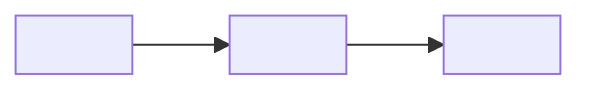
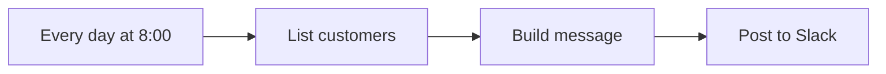

Turn the decisions already settled in this conversation into a diagram and a short decision summary, in the chat. Write only: do not open a new round of questions, and write no file.

Rules:

- **Settled decisions only.** Each line comes from the user's answers or from the project files. Anything you would have to guess goes under **Open assumptions**, never in another section.
- **The template is strict.** `BOILERLIFT:ship` builds from it and `BOILERLIFT:qa` tests against it: keep the headings, their names and their order. Drop a section that would be empty, but never **Diagram**, **Goal** or **Nodes**.
- **Short.** One decision per bullet, concrete enough to check on the deployed workflow. The whole summary fits on one screen.
- **The diagram is the nodes.** One mermaid box per node of **Nodes**, with the same name, and one arrow per connection. Label an arrow when the node branches (`true`, `false`, `error`). Quote a label that holds punctuation: `A["Every day at 8:00"]`.
- **No secret.** Name each credential by its key, never by its value.
- **Exact text stays exact.** Copy a message, a subject line or a field name the user gave verbatim, in its language.

## Template

````markdown
## Diagram



## Decisions

### Goal
<one or two sentences: what the workflow does, for whom>

### Scope
- Workflow: `workflows/<name>.workflow.ts`, titled `<title in n8n>`, on target `dev`
- Trigger: <what starts it>
- Inputs: <the data it receives>
- Services & credentials: <each service, with its credential key>
- Expected result: <what it produces, writes or sends, and where>

### Out of scope
- <what was excluded>

### Nodes
1. `<node name>` (<node type>): <what it does>
2. `<node name>` (Code node, `code/<name>.ts`): <what the function does>

### Edge cases & rules
- <each rule or failure case the interview settled>

### Open assumptions
- <anything left to your judgement>
````

## Example

For "Every morning, post yesterday's new Stripe customers in Slack":

````markdown
## Diagram



## Decisions

### Goal
Each morning, the sales channel in Slack gets the list of the customers Stripe created the day before.

### Scope
- Workflow: `workflows/daily-new-customers.workflow.ts`, titled `Daily new customers`, on target `dev`
- Trigger: every day at 8:00, Europe/Paris.
- Inputs: the Stripe customers created the day before.
- Services & credentials: Stripe (`stripe`), Slack (`slack`).
- Expected result: one message in `#sales` with each customer's name and email.

### Out of scope
- Customers deleted the same day.

### Nodes
1. `Every day at 8:00` (Schedule Trigger): runs at 8:00, Europe/Paris.
2. `List customers` (Stripe, credential `stripe`): the customers created yesterday.
3. `Build message` (Code node, `code/new-customers-message.ts`): one line per customer, `<name> — <email>`.
4. `Post to Slack` (Slack, credential `slack`): posts the message to `#sales`.

### Edge cases & rules
- No new customer: post `No new customer yesterday.`
- A customer without a name: show the email alone.

### Open assumptions
- "Yesterday" is the previous calendar day in Europe/Paris.
````
